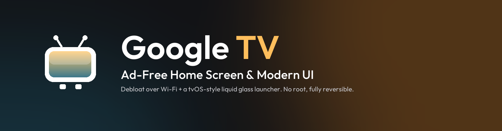
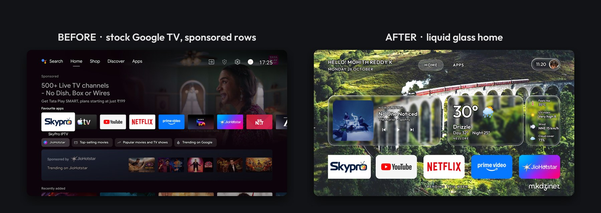
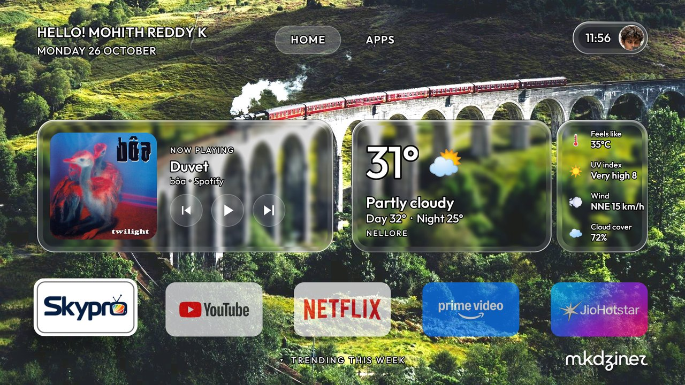
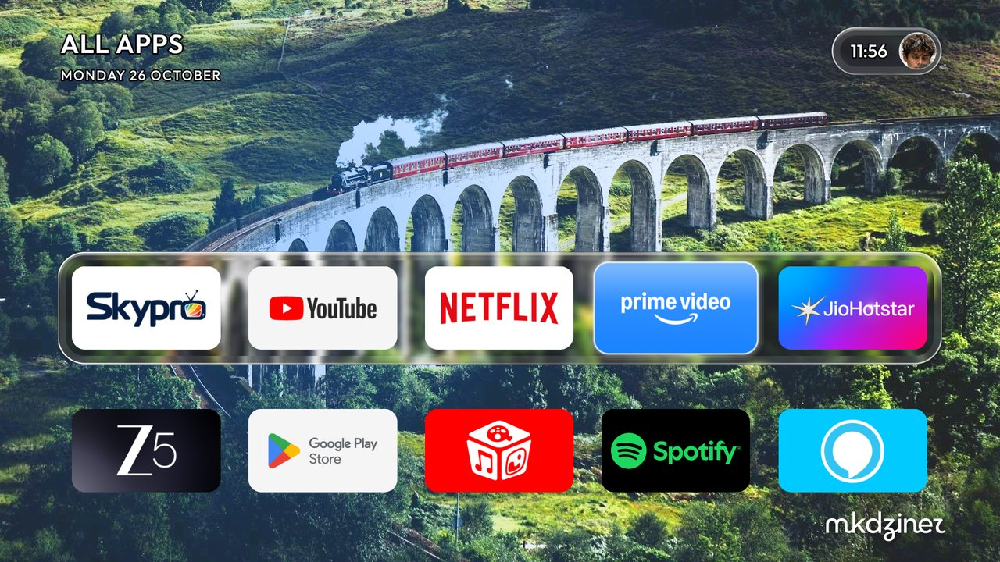
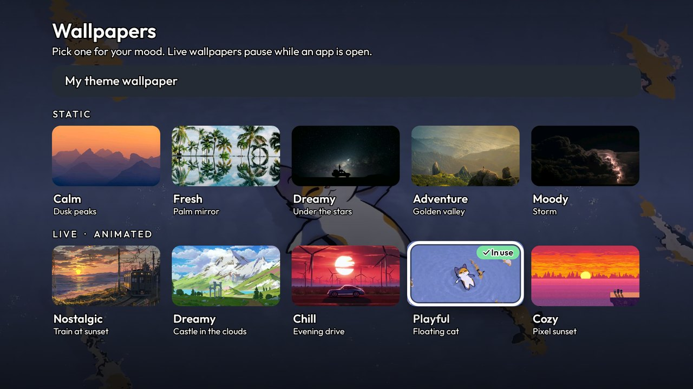
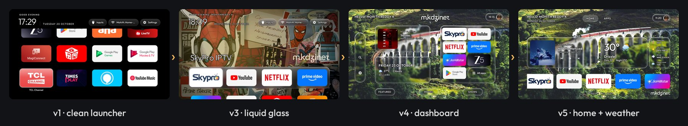

<p align="center">
  
</p>

<p align="center">
  <b>An ad-free Google TV with a tvOS-inspired, liquid-glass dashboard.</b><br>
  Debloated over Wi-Fi · no root · nothing uninstalled · one-command restore
</p>

<p align="center">
  <a href="#features">Features</a> ·
  <a href="#screenshots">Screenshots</a> ·
  <a href="#how-it-works">How it works</a> ·
  <a href="#getting-started">Getting started</a> ·
  <a href="#configuration">Configuration</a> ·
  <a href="HOW-TO-RESTORE.md">Restore</a> ·
  <a href="CHANGELOG.md">Changelog</a>
</p>

<p align="center">
  
  
  
  <a href="LICENSE"></a>
  <a href="https://github.com/MinatoXmohith/Google-TV-Ad-Free-Home-Screen-Modern-UI/commits/main"></a>
</p>

---



My TCL Google TV showed a sponsored ad before I could even open Netflix. This project removes the
ads and telemetry over Wi-Fi and replaces the home screen with a dashboard I designed in Figma,
inspired by Apple's tvOS 2026 and built as a native Android TV launcher.

> **Built on [CleanYourTV](https://github.com/Gathin23/cleanyourtv) by Gathin ([@gathint](https://x.com/gathint) · [GitHub](https://github.com/Gathin23)).**
> The debloat tools, restore system and original launcher are his open-source work (MIT); this project adds the
> dashboard, liquid glass UI, weather and music on top. (Trending is switched off for now, in Lumen 3.1.)

## Features

| | |
|---|---|
| 🧹 **Debloat over Wi-Fi** | 11 telemetry, ad and promo apps switched off with `pm disable-user`. Nothing uninstalled, everything reversible. |
| 🪟 **Liquid glass UI** | Clear glass cards with a light blur, edge refraction and a specular rim. Android 9 has no live blur, so it's computed once from the wallpaper. |
| 👋 **Personal header** | Greeting with your name and the date, **HOME · APPS** tabs, and a status pill with the time and your photo that opens Inputs, Wi-Fi and Settings. |
| 🎵 **Now playing** | Shows whatever is playing (Spotify, YouTube Music…) with album art and controls. Remote media keys work too. |
| 🌤 **Weather** | Live from [Open-Meteo](https://open-meteo.com) (free, no account): temperature, condition, day / night, feels like, UV index, wind and cloud cover. |
| 📱 **Favourite apps** | Five favourite apps on the home screen; the **APPS** tab opens the full grid. |
| 🖼 **Wallpapers by mood** | Launcher settings → Wallpapers: five **static** and five **live** (animated) wallpapers, each tagged with a mood. Live ones are muted video loops that keep playing in All apps and stop the moment an app opens, so the app always gets the TV's video decoder. |
| 🌊 **Smooth motion** | One set of motion curves everywhere, spring physics for focus, menus that fade out, and launcher animations that keep their designed speed even with the system at 0.5×. |
| ⚡ **Faster TV** | System animations at 0.5× and the main apps pre-compiled. |
| ↩️ **Fully reversible** | A backup comes first, and one command restores the stock TV. |

## Screenshots

| | |
|---|---|
|  |  |
| **Home:** greeting, HOME · APPS tabs, now playing, weather with details, five favourite apps | **Live wallpaper on Home:** the video plays behind the glass, which shows the motion through it |
|  |  |
| **Control panel:** the time pill opens Inputs, Wi-Fi, Settings and launcher settings | **All apps:** the APPS tab; it grows in from the tab and shrinks back on Home |
|  | |
| **Wallpapers:** pick by mood, Static or Live; your pick previews behind the cards | |

### Design journey



Each version started as Figma frames ([v5 home](docs/design/figma-home-v5.jpg) · [v4 dashboard](docs/design/figma-dashboard.jpg) ·
[first layout](docs/design/figma-first-layout.jpg)) and was refined on the real TV.

## How it works

Android TVs have the same debug bridge (ADB) as Android phones. Enable USB debugging, allow the
computer once on the TV, and everything else runs over Wi-Fi:

1. **Back up:** packages, settings and system properties are saved before any change (kept locally, not published: it contains the TV's serial number).
2. **Debloat:** the apps in [`my-tv-debloat.txt`](my-tv-debloat.txt) are disabled for the user, never uninstalled.
3. **Install the launcher:** a small native Java app (~400 KB, AndroidX RecyclerView only) becomes the default Home.
4. **Apply the theme:** wallpaper, layout, name, photo and city come from [`my-theme/`](my-theme) and can be changed without a rebuild.

```
 Mac / PC ──Wi-Fi (ADB :5555)──▶ TV
   │                               ├─ disable bloat (reversible)
   │                               ├─ install launcher → Home
   └─ theme.sh ───────────────────▶└─ config.json · wallpaper.jpg · avatar.jpg · tmdb_key.txt
```

## Getting started

**Requirements:** an Android TV / Google TV on the same Wi-Fi as your computer, Python 3, and
JDK 17+ with Android SDK platform 34 to build the launcher.

**1. On the TV:** Settings → Device Preferences → About → press **Build** seven times → Developer
options → turn on **USB debugging** (and **Network debugging** if present). Note the TV's IP address.

**2. On your computer:**

```bash
git clone https://github.com/MinatoXmohith/lumen
git clone https://github.com/MinatoXmohith/Google-TV-Ad-Free-Home-Screen-Modern-UI tv-setup
cd lumen
python3 -m venv tools/venv && tools/venv/bin/pip install -r tools/requirements.txt
export TV_HOST=192.168.1.50                      # your TV's IP

tools/venv/bin/python -I tools/tv.py --probe    # accept "Allow USB debugging?" on the TV
tools/disable.sh ../tv-setup/my-tv-debloat.txt  # backup, then disable bloat
launcher/build-and-install.sh                   # build the launcher and set it as Home
tools/theme.sh ../tv-setup/my-theme             # wallpaper, name, photo, weather, posters
tools/wallpapers.sh ../tv-setup/wallpapers/tv   # optional: your own mood wallpapers (see below)
```

> Package names differ by brand. On another model, start from the matching list in
> [CleanYourTV's `examples/`](https://github.com/Gathin23/cleanyourtv/tree/main/examples).

**3. When you're done:** turn **USB debugging** off, **revoke authorisations** and restart the TV.
The launcher keeps working without debugging.

## Configuration

Everything lives in [`my-theme/`](my-theme). Edit it, then push it again with `tools/theme.sh`.

| File / key | Purpose |
|---|---|
| `config.json` → `greeting_name` | Name in the greeting and the avatar initials |
| `config.json` → `weather_city` | City for the weather card, e.g. `"Mumbai"` |
| `config.json` → `dock_apps` / `hidden_apps` | Order of favourite apps, and apps to hide |
| `config.json` → `music_app` | App opened by ▶ when nothing is playing (optional) |
| `wallpaper.jpg` | 1920×1080 background; the glass is computed from it |
| `avatar.jpg` | Square photo for the status pill |
| `tmdb_key.txt` | Your free [TMDB API key](https://www.themoviedb.org/settings/api). **Git-ignored, never commit it.** |

### Mood wallpapers

The Wallpapers screen shows the launcher's built-in set (five images and five animated scenes) until you push
your own. Put five images and five videos in a folder with a
[`wallpapers.json`](wallpapers/tv/wallpapers.json) that names each one's file, thumbnail, mood and title, then:

```bash
TV_HOST=<TV-IP> lumen/tools/wallpapers.sh wallpapers/tv     # --reset goes back to the built-in set
```

Make everything TV-sized first, since 4K files are wasted on a 1080p TV:

```bash
# image: 1920×1080 JPEG; video: 1080p H.264, muted, ≤4 Mbps; thumbnail: one frame at 480×270
ffmpeg -i in.mp4 -an -vf "scale=1920:1080,fps=30,format=yuv420p" -c:v libx264 -profile:v main -crf 23 -maxrate 4M -bufsize 8M -movflags +faststart live/name.mp4
ffmpeg -ss 3 -i live/name.mp4 -frames:v 1 -vf scale=480:270 live/name.jpg
```

## Restoring the TV

```bash
TV_HOST=<TV-IP> tools/restore.sh ../tv-setup/my-tv-debloat.txt
```

This re-enables every app and the original Google TV home. Without a computer, use the TV's
**Settings → Apps → Show system apps → Enable**. Full details are in [HOW-TO-RESTORE.md](HOW-TO-RESTORE.md).

## Tested on

| | |
|---|---|
| TV | TCL BeyondTV (India), Realtek, 2 GB RAM |
| System | Android TV 9, build `PPR1.180610.011` |
| Kept working | Live TV & HDMI, remote & Bluetooth, keyboard, Play Store, Chromecast |

**Known quirks:** TCL's startup re-enables the Reminder app, so its tile is hidden through `hidden_apps`.
This TV has no AirPlay receiver, so to show a Mac on it, use Chrome → **Cast → Cast screen**.

## Repository layout

```
├── my-theme/            theme pushed to the TV (config, wallpaper, avatar)
├── my-tv-debloat.txt    apps switched off
├── wallpapers/          wallpaper sources, the mkdziner logo, built-in mood art and wallpapers.json
├── docs/                README images, Figma frames, design journey
├── HOW-TO-RESTORE.md    every change and how to undo it
└── CHANGELOG.md         version history
```

The launcher is now its own app, **[Lumen](https://github.com/MinatoXmohith/lumen)** (`com.mkdziner.tvhome`). Its history as a CleanYourTV fork stays on the [`my-tv-setup` branch](https://github.com/MinatoXmohith/cleanyourtv/tree/my-tv-setup).

## Credits

- [CleanYourTV](https://github.com/Gathin23/cleanyourtv) by [@gathint](https://x.com/gathint) (MIT): the ADB tools, restore system and launcher base.
- Weather by [Open-Meteo](https://open-meteo.com) (CC BY 4.0).
- Movie and show data from [TMDB](https://www.themoviedb.org). *This product uses the TMDB API but is not endorsed or certified by TMDB.*
- [Outfit](https://fonts.google.com/specimen/Outfit) typeface (SIL Open Font License).
- Design, UI and setup by **mkdziner** ([@MinatoXmohith](https://github.com/MinatoXmohith)), built with [Claude Code](https://claude.com/claude-code).

## Licence

Code, configuration and docs: [MIT](LICENSE). The mkdziner logo, artwork and photos are not covered,
see [NOTICE.md](NOTICE.md). Posters and app logos in screenshots belong to their owners.
