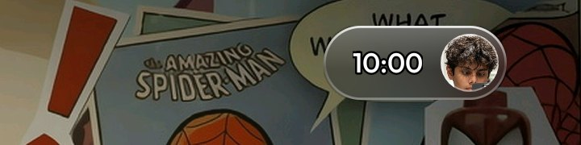
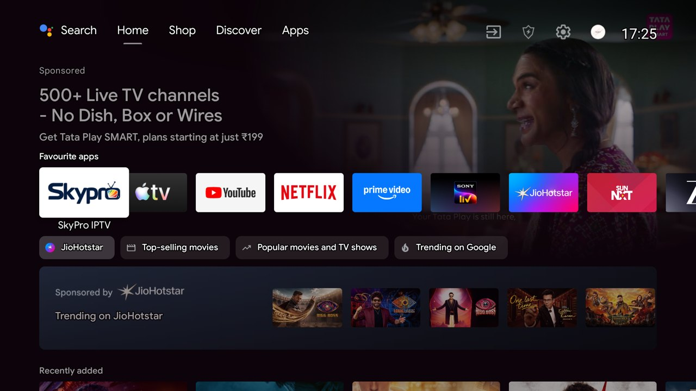
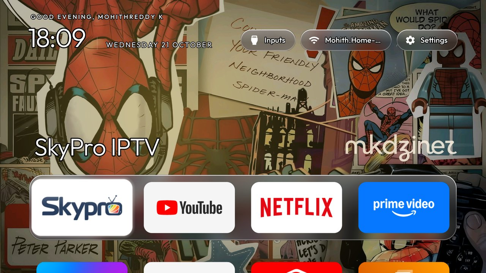
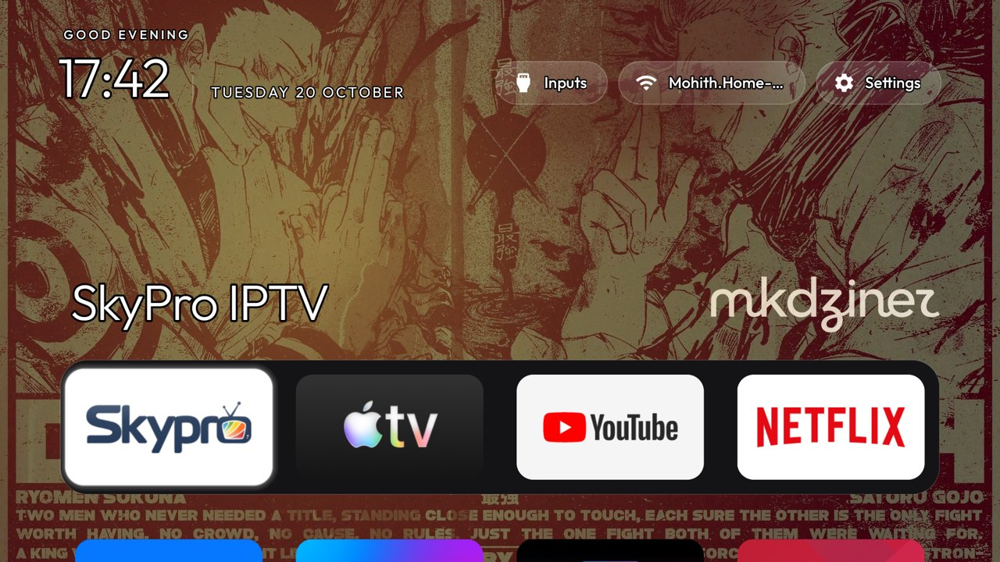

<p align="center">
  
</p>

<p align="center">
  <a href="#before-and-after">Before &amp; after</a> ·
  <a href="#how-it-works">How it works</a> ·
  <a href="#screenshots">Screenshots</a> ·
  <a href="#do-it-yourself">Do it yourself</a> ·
  <a href="HOW-TO-RESTORE.md">Restore</a> ·
  <a href="https://github.com/MinatoXmohith/cleanyourtv/tree/my-tv-setup">Launcher code</a>
</p>

<p align="center">
  <a href="https://github.com/MinatoXmohith/Google-TV-Ad-Free-Home-Screen-Modern-UI/stargazers"></a>
  <a href="https://github.com/MinatoXmohith/Google-TV-Ad-Free-Home-Screen-Modern-UI/network/members"></a>
  <a href="https://github.com/MinatoXmohith/Google-TV-Ad-Free-Home-Screen-Modern-UI/commits/main"></a>
  
  
  <a href="LICENSE"></a>
</p>

My TCL Google TV showed a sponsored Tata Play ad before you could even reach Netflix. This repo has
everything I used to fix that: the TV is **debloated over Wi-Fi**, and the ad-filled home screen is
replaced with a **tvOS 2026 style launcher with liquid glass**. **No root, no cable, nothing flashed,
and a one-command restore.**

<h3 align="center">11 apps switched off &nbsp;·&nbsp; 0 uninstalled &nbsp;·&nbsp; 5-app glass dock &nbsp;·&nbsp; 1-command restore</h3>

## Before and after


> Built on 20–22 October 2026 with [Claude Code](https://claude.com/claude-code) and
> [CleanYourTV](https://github.com/Gathin23/cleanyourtv). The TV is a TCL BeyondTV (India, Android TV 9).

## How it works

Android TVs have the same debug bridge (ADB) as Android phones. Switch on USB debugging, allow your
computer once on the TV, and everything else is standard Android tooling over Wi-Fi:

1. **Back up.** A full snapshot of installed packages, settings and system properties comes first. It's in [`backup-20261020-1723/`](backup-20261020-1723).
2. **Debloat.** TCL telemetry, ad and promo feeds, the recommendation rows and preloaded extras are switched off with `pm disable-user`. Nothing is uninstalled, so every step can be undone. The list is [`my-tv-debloat.txt`](my-tv-debloat.txt).
3. **New home screen.** A small native launcher (about 380 KB) is built, installed and made the default Home. Its look comes from a theme in [`my-theme/`](my-theme), which can be changed without a rebuild.

## What you get

- **A greeting with your name** in two bold lines, with the date underneath, in [Outfit](https://fonts.google.com/specimen/Outfit).
- **A status pill** at the top right with the time and your profile photo, like Apple TV's profile button.
- **A control panel.** Select the pill and it opens in place into a glass panel with **Inputs** (HDMI, AV, Live TV), **Wi-Fi** (with the network name) and **Settings**.
- **Liquid glass.** The pill, the dock and every menu show the wallpaper blurred behind them, with a top sheen and a bright rim. Android 9 has no live blur, so the blur is made once from the wallpaper. It costs about 130 KB of memory.
- **A dock of five apps** in a glass band in the middle of the screen, with the rest of the apps in a grid below.
- **Your own wallpaper and logo** from the theme: no ads, no "Discover" rows, no sponsored tiles.
- **Faster everyday use.** Animations run at 0.5× and the main apps are pre-compiled, so they open faster.

## Screenshots

| | |
|---|---|
|  |  |
| *Home: greeting, status pill, glass dock, 5 apps per row* | *The pill opens into Inputs / Wi-Fi / Settings* |
|  |  |
| *Status pill: time and profile photo on glass* | *Before: sponsored rows on the stock Google TV home* |
|  |  |
| *First liquid glass version, three separate pills* | *An earlier theme: the Domain Clash poster* |

## My TV

| | |
|---|---|
| Model | TCL BeyondTV, India (Realtek, 2 GB RAM) |
| System | Android TV 9, build `PPR1.180610.011`, security patch 5 January 2021 |
| Switched off | TCL analytics (`com.tcl.bi`), TCL home content pushes, TCL web feed, demo stickers, "cleaner" widget, note reminder, TCL app store, TCL Channel, MagiConnect, Google recommendation rows, the stock Google TV home |
| Kept | Live TV and HDMI (`com.tcl.tv`), remote and Bluetooth services, keyboard, Play Store and Play Services, Chromecast |

## Do it yourself

You need a Mac, Windows or Linux computer on the same Wi-Fi as the TV, and Python 3.

**1. On the TV:** Settings → Device Preferences → About → press OK on **Build** seven times → back →
Developer options → **USB debugging** on (and **Network debugging** if you see it). Find the TV's IP
under Settings → Network & Internet.

**2. On your computer:**

```bash
git clone -b my-tv-setup https://github.com/MinatoXmohith/cleanyourtv
git clone https://github.com/MinatoXmohith/Google-TV-Ad-Free-Home-Screen-Modern-UI tv-setup
cd cleanyourtv
python3 -m venv tools/venv && tools/venv/bin/pip install -r tools/requirements.txt
export TV_HOST=192.168.1.36                                    # your TV's IP

tools/venv/bin/python -I tools/tv.py --probe                  # accept "Allow USB debugging?" on the TV
tools/disable.sh ../tv-setup/my-tv-debloat.txt                # back up state, then switch the apps off
launcher/build-and-install.sh                                 # build the launcher and make it Home
tools/theme.sh ../tv-setup/my-theme                           # wallpaper, layout, greeting name, avatar
```

Building the launcher needs JDK 17 or newer and Android SDK platform 34. On another TV model, start from the
matching list in [CleanYourTV's `examples/`](https://github.com/Gathin23/cleanyourtv/tree/main/examples)
rather than mine, because package names differ between brands.

**3. Make it yours:** edit [`my-theme/config.json`](my-theme/config.json) (`greeting_name`, `columns`,
`rows_below_dock`, `hidden_apps`), replace `wallpaper.jpg` (1920×1080, dark enough for white text) and
`avatar.jpg` (square), then push it again with `tools/theme.sh`.

**4. Close the door when you're done:** Developer options → turn off USB and Network debugging →
**Revoke USB debugging authorisations** → restart the TV. The launcher keeps working without debugging.

## Restoring the TV

Everything is reversible. One command brings back every app and the original Google TV home:

```bash
TV_HOST=192.168.1.36 tools/restore.sh ../tv-setup/my-tv-debloat.txt
```

Without a computer, the TV's own **Settings → Apps → Show system apps** can turn any app back on.
[`HOW-TO-RESTORE.md`](HOW-TO-RESTORE.md) covers each change: the debloat, the launcher code, the
animation speed and the theme.

## Things that bit me

- **macOS says "No route to host"** for `adb connect` and `nc`. That's macOS Local Network privacy, not the TV. `tools/tv.py` is a pure-Python ADB client that works anyway.
- **The Reminder app comes back after every restart.** TCL's own startup code switches `com.tcl.notereminder` on again, so its tile is also hidden through `hidden_apps` in the theme.
- **"App info → Uninstall" in the launcher really uninstalls.** Holding OK on a tile opens Android's App info page, and the Uninstall button there removes the app for real. Reinstall from the Play Store if it happens by accident.
- **No AirPlay on this TV.** MagiConnect has no AirPlay receiver in this firmware. To show a MacBook on the TV, use Chrome → ⋮ → **Cast…** → **Cast screen** to the built-in Chromecast.

## Repository layout

| Path | What it is |
|---|---|
| [`my-tv-debloat.txt`](my-tv-debloat.txt) | The apps that were switched off |
| [`my-theme/`](my-theme) | The theme on the TV: `config.json`, `wallpaper.jpg`, `avatar.jpg` |
| [`HOW-TO-RESTORE.md`](HOW-TO-RESTORE.md) | What was changed, and how to undo each part |
| [`backup-20261020-1723/`](backup-20261020-1723) | Snapshot of the TV before any change |
| [`wallpapers/`](wallpapers) | Wallpaper sources and versions, and the mkdziner logo |
| [`docs/`](docs) | README images; `docs/screenshots/original/` has every screenshot taken during setup |
| [Launcher code](https://github.com/MinatoXmohith/cleanyourtv/tree/my-tv-setup) | Fork of CleanYourTV, branch `my-tv-setup`: liquid glass, status pill, control panel, greeting, avatar |

## Credits

- [CleanYourTV](https://github.com/Gathin23/cleanyourtv) by [@gathint](https://x.com/gathint) (MIT): the ADB tools, the restore system and the launcher this is built on.
- [Outfit](https://fonts.google.com/specimen/Outfit) typeface (SIL Open Font License).
- Design and setup by **mkdziner** ([@MinatoXmohith](https://github.com/MinatoXmohith)).

## Licence

Scripts, configuration and documentation: [MIT](LICENSE). Wallpapers, the mkdziner logo, the Domain
Clash poster and the profile photo are **not** covered by the MIT licence. See [LICENSE](LICENSE) for details.
